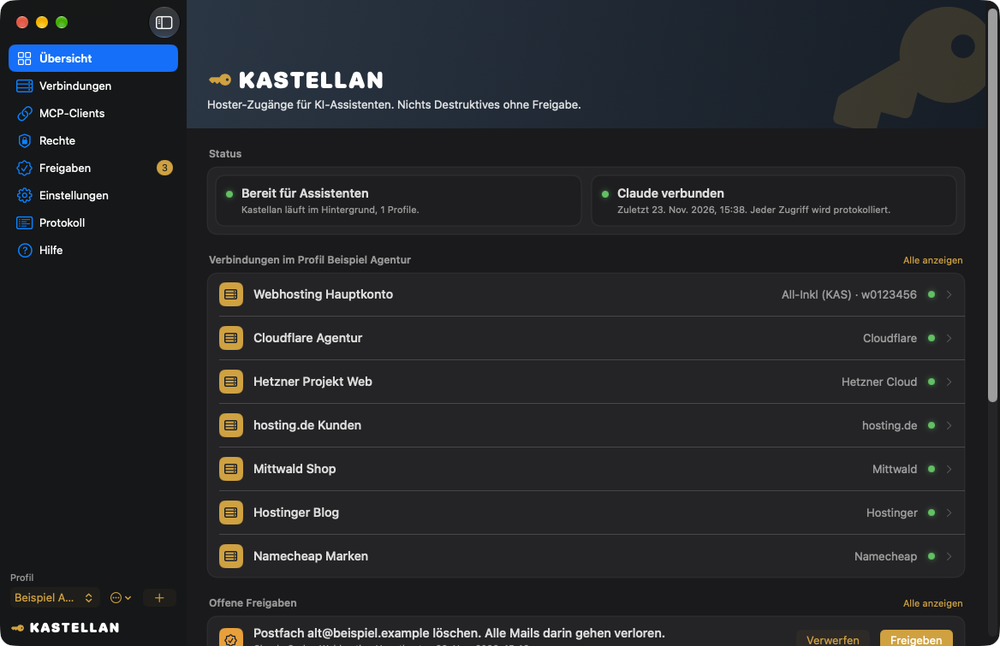
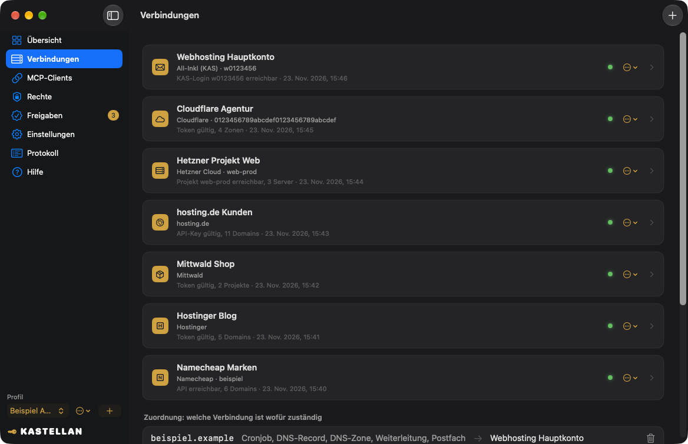
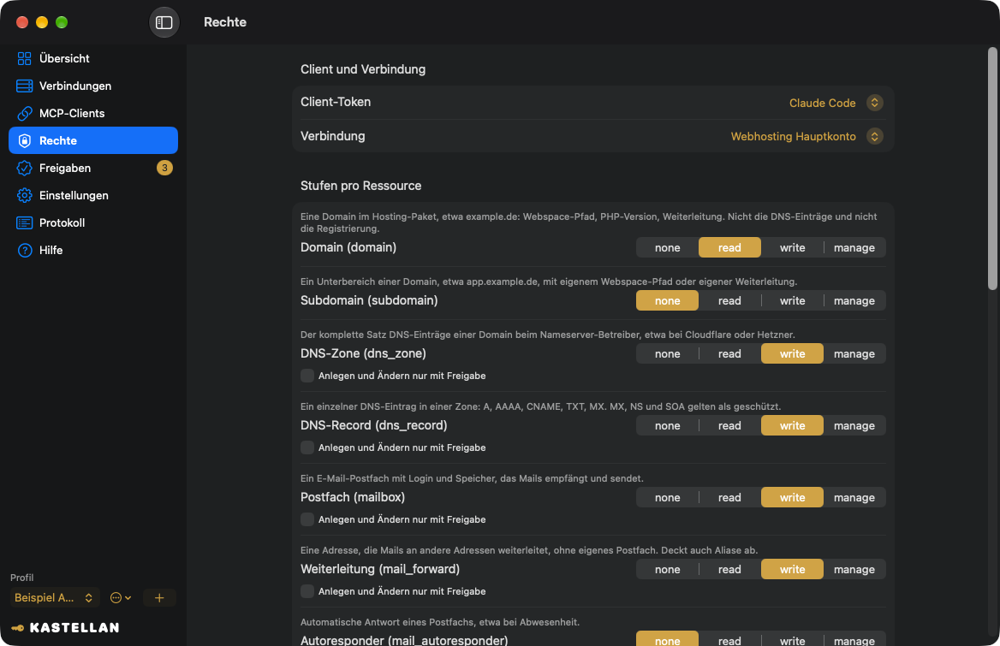
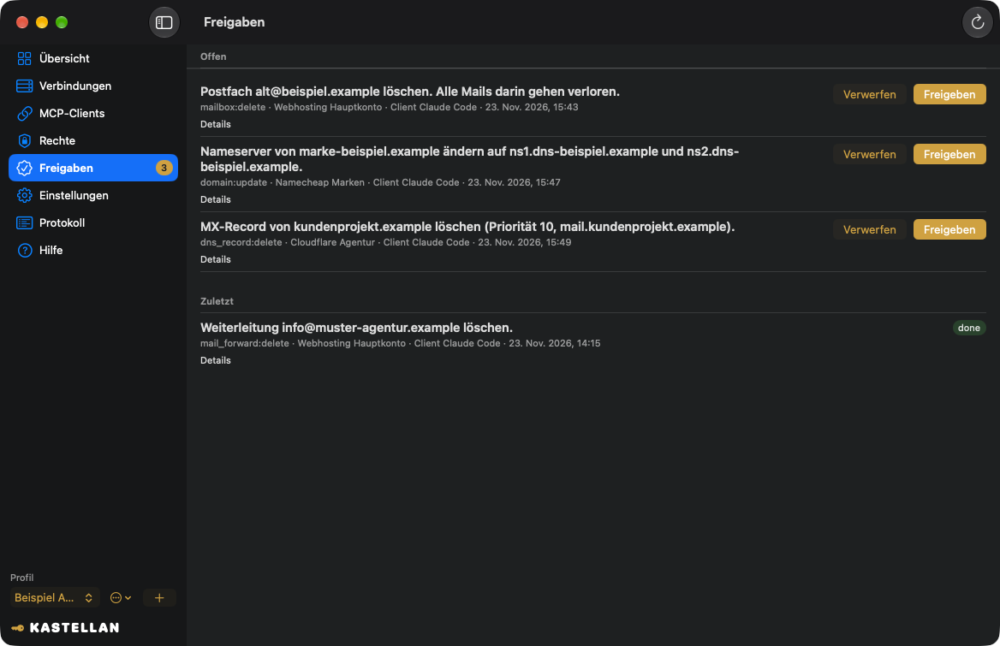
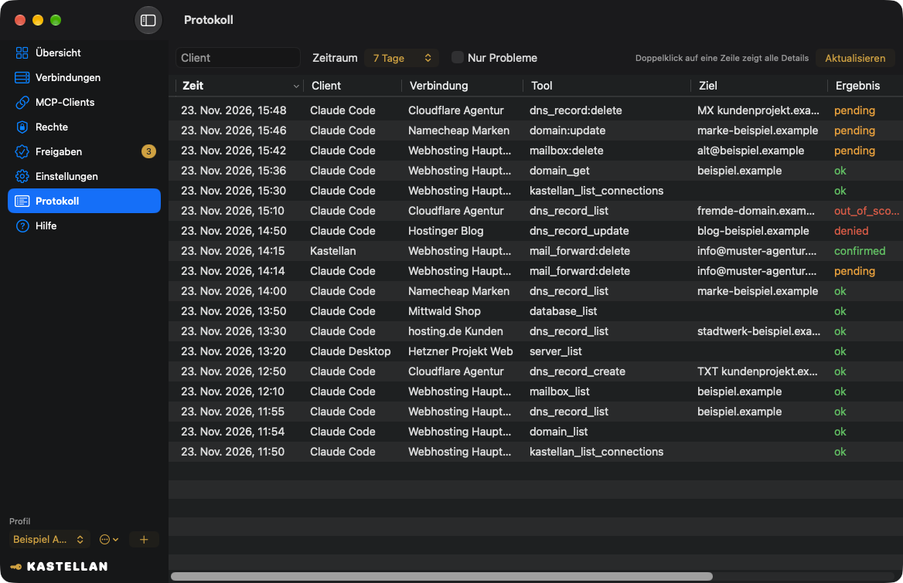
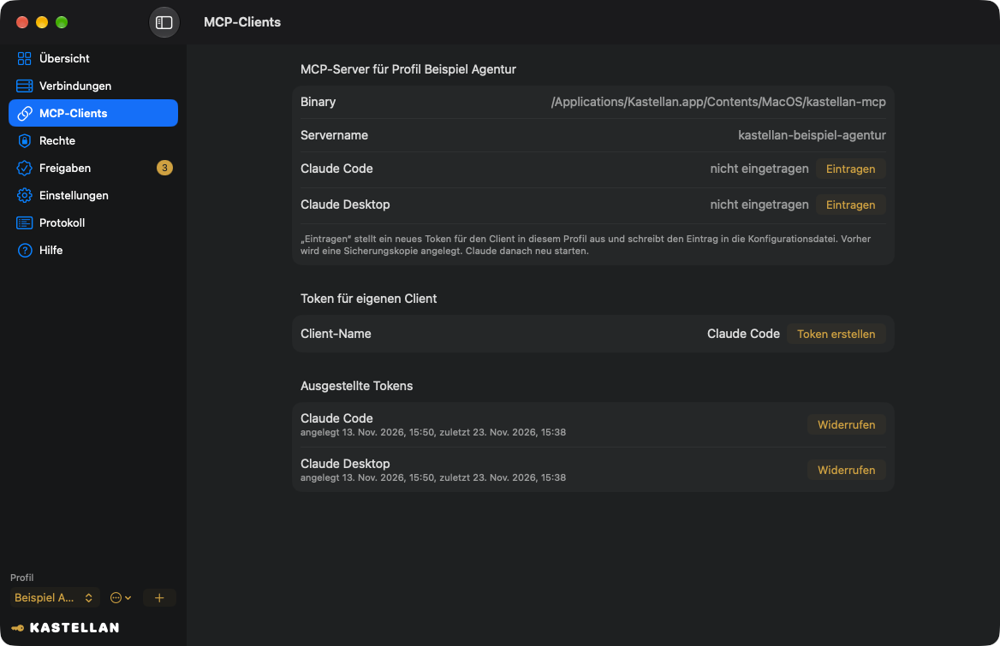

<p align="center">
  
</p>

# Kastellan

[](#installation)
[](#linux-and-windows)
[](Packages/KastellanCore)
[](https://github.com/toolwerk/kastellan/releases/latest)
[](LICENSE)

[Deutsch](README.md) · **English**

**Kastellan gives AI assistants access to your hosting providers without handing them the keys.** The macOS app keeps credentials and permissions for mailboxes, forwards, DNS, databases, cron jobs and servers at seven providers. A built-in MCP server offers Claude and other agents exactly the actions you allowed. Anything risky, such as deleting something or switching nameservers, is only prepared by the assistant. You are the only one who can run it, with one click on Approve.



The name comes from the castle steward: the Kastellan ran the castle on behalf of its lord, held the keys, guarded the gates and kept the books. KAS is in there too, the admin interface of All-Inkl that this project started with.

The app itself is in German. This page describes it in English; screenshots show the German interface.

## What it is for

An assistant that should set DNS records or create a mailbox needs access to the provider. If you give it the API token directly, it can do everything: including delete every domain in the account when it makes a mistake or when someone tricks it with a crafted text.

Kastellan puts a layer in between:

- The assistant never sees a password or a token. Both live in the keychain.
- Each assistant gets a level per connection: none, read, write or manage.
- Deleting and other irreversible actions go through an approval in the app.
- Every access is logged, including the refused ones.

## What Kastellan can do

### Seven providers, one model

| Provider | Access | Covers |
|---|---|---|
| All-Inkl (KAS) | KAS login and password | Domains, subdomains, DNS, mailboxes, forwards, autoresponders, DKIM, FTP, databases, cron jobs, directory protection |
| Cloudflare | API token | DNS zones and records, Email Routing, certificates (read) |
| Hetzner Cloud | Project token | DNS, servers with power actions, SSH keys, firewalls (read) |
| hosting.de | API key | DNS, domains, mail, webspace users, databases, cron jobs, directory protection, certificates, servers |
| Mittwald (mStudio) | API token | Servers, domains, ingress, DNS, mail, MySQL, SSH/SFTP, cron jobs, certificates, invitations |
| Hostinger | API token | Domains, DNS with dry run, VPS, firewalls, mail, hosting databases and cron jobs |
| Namecheap | API key, whitelisted IPv4 | Domains with nameservers, lock and privacy, DNS as a whole zone, mail forwards, certificates (read) |

All providers look the same to the assistant. A tool like `dns_record_list` works at Cloudflare, All-Inkl and Namecheap with the same parameters. What a provider does not offer through its API, Kastellan does not offer either. The app shows what each connection can actually do.



### Nineteen resource types

Kastellan knows domain, subdomain, DNS zone, DNS record, mailbox, forward, autoresponder, mailing list, DKIM, FTP user, SSH user, database, database user, cron job, certificate, directory protection, subaccount, server and firewall. The actions are `list`, `get`, `create`, `update`, `set_password` and `delete`. Each adapter reports in advance what its provider can do. If an assistant asks for something the provider cannot do, Kastellan refuses the call with a clear message and logs it.

### Assignment: who is responsible for what

Web space and mail often sit at one provider and DNS at another. Under Connections you decide which connection is responsible for which domain and resource type. The assistant only asks about `example.com` and `dns_record`. Kastellan sends the request to the right provider.

### Permissions per assistant and connection

For every MCP client and every connection you set one of four levels per resource type:

| Level | Allows |
|---|---|
| `none` | nothing, every call is refused and logged |
| `read` | list and read |
| `write` | create and change |
| `manage` | additionally delete, after approval |

The effective permission is the intersection of your setting, what the provider can do and the scope. You narrow the scope with domain patterns, excluded targets and allowed record types, for example only `TXT` and `CNAME`. You can also limit writes per hour and make further actions require approval.



### Approvals for anything risky

The assistant never runs these actions itself: deleting, changes to MX, NS and SOA records, nameserver changes, removing a domain, subaccounts. The assistant calls the matching `prepare` tool and Kastellan creates a preview: what exactly will happen, on which connection, for which target. You see it under Approvals and choose between Discard and Approve. Only then does the action run. Policies can extend the fixed list but never shorten it.



### Log

Every call ends up in `audit.jsonl`: time, client, connection, tool, target, result and duration. Refused calls, calls outside the scope and approvals are in there too, without passwords and tokens. In the app you filter by client, time range and problems.



### Passwords

When an assistant creates a mailbox or a database user, Kastellan can generate the password. Where it goes is set per profile: only into the result, into the keychain, to Bitwarden or to 1Password. By default the assistant does not see the generated password.

### Profiles

A profile bundles connections, assignments, tokens and permissions, for example one for your own agency and one for a client. Each profile has its own MCP server entry. An assistant in the profile "Client A" does not see the connections of "Client B".

### Setting up MCP clients

One click issues a token and writes the entry into the configuration of Claude Code or Claude Desktop, with a backup of the old file. Further clients get their own token with their own permissions. Tokens can be revoked one by one. Only hashes are stored.



### What you can say to Claude

With a matching connection, sentences like these work:

- "Which domains do we have at All-Inkl, and when does the next one expire?"
- "Set a TXT record for `example.com` for the Google domain verification."
- "Create `info@example.com` and forward it to `team@agency.example`."
- "Check whether SPF and DKIM are set for every domain."
- "Restart the Hetzner server `web-1`."
- "Delete the mailbox `old@example.com`." Claude only prepares this one. You confirm in the app.

### More features

- **Self-updating:** The macOS app checks for new versions at launch and every 24 hours, downloads them in the background and installs them at the next quit. Each package is additionally signed with an Ed25519 key that Sparkle verifies before installing.
- **Health check:** Every connection is checked, and the app shows the result with a timestamp.
- **Rate limits in the adapter:** Kastellan keeps to the providers' limits (for example the wait after each KAS response) and works through each connection one call at a time.
- **Same behavior without a Mac:** The terminal interface and the MCP server also run on Linux and Windows, see below.

## Installation

The finished app is under [Releases](../../releases): download the DMG, drag `Kastellan.app` to Applications, start it. The app is signed with a Developer ID and notarized by Apple. macOS 14 or newer is required.

Since version 0.2.0 Kastellan updates itself. You can switch that off under Settings → Updates.

Then in the app:
1. Add your first provider under Connections. Credentials go into the macOS keychain.
2. Under Permissions, decide what an assistant may do per connection: none, read, write or manage.
3. Under MCP clients, issue a token for Claude Code or Claude Desktop and let the app write the configuration.

### Linux and Windows

Without macOS, Kastellan comes as the terminal interface `kastellan` with the MCP server `kastellan-mcp` next to it. The interface does the same as the app: add and check connections, set permissions, set up MCP clients, grant approvals, read the log. `kastellan status` shows the state without the interface.

Linux (x86_64, arm64), for the current user into `~/.local/bin`:

```sh
tools/install-linux.sh --release      # prebuilt programs from the latest release
tools/install-linux.sh                # build from the checkout (Swift 6)
kastellan autocheck enable            # approvals and outages as a desktop notification (systemd user timer)
```

Credentials are kept in the desktop's Secret Service (`secret-tool` from libsecret), data in `~/.local/state/kastellan`.

The Linux and Windows packages are not signed; `SHA256SUMS` in the release lets you verify them with `sha256sum -c SHA256SUMS`. Windows shows a SmartScreen warning on first start (More info → Run anyway).

Windows (x64, arm64, experimental): unzip the release and start `kastellan.exe` in Windows Terminal. Credentials are kept in the Credential Manager, data in `%LOCALAPPDATA%\Kastellan`.

## MCP setup

The server is at `Kastellan.app/Contents/MacOS/kastellan-mcp`. The app writes the entry at the push of a button. By hand it looks like this:

```json
"kastellan": {
  "type": "stdio",
  "command": "/Applications/Kastellan.app/Contents/MacOS/kastellan-mcp",
  "env": { "KASTELLAN_TOKEN": "<token from the app>" }
}
```

Without a valid token the server starts but reports no tools. `kastellan-mcp doctor` shows profiles, connections and whether the keychain is readable.

Besides the resource tools (`<resource>_<action>`, for example `mailbox_list`) there are general tools with the prefix `kastellan_`: list connections and capabilities, read your own policy, find out which connection is responsible for a domain, view open approvals and, if you allow it, confirm or cancel them. Tool descriptions are in German and English.

## Privacy

- Credentials live only in the keychain, never in files or in the log.
- No MCP tool writes credentials. You enter them only in the app.
- Generated passwords go, per profile, only into the result, into the keychain, to Bitwarden or to 1Password.
- Error telemetry is off by default. When switched on, the app reports error type, message, component, provider and action to the project's GlitchTip instance or to your own DSN (`KASTELLAN_SENTRY_DSN`), never passwords, tokens or parameters.
- No analytics, no tracking.

## What Kastellan does not do

No scrapers for providers without an API, no domain purchases, no invoice or contract management.

## Building from source

```
Kastellan/                 SwiftUI app (connections, permissions, approvals, log, settings)
kastellan-mcp/             MCP server (stdio), embedded in Kastellan.app/Contents/MacOS
Packages/KastellanCore/    Swift package: resource model, permissions, audit, one adapter per provider
KastellanTests/            app tests
tools/                     build, release and probe scripts
project.yml                XcodeGen definition, the .xcodeproj is generated from it
```

Requirements: Xcode 16 or newer (Swift 6) and [XcodeGen](https://github.com/yonaskolb/XcodeGen) (`brew install xcodegen`).

```bash
./setup.sh
(cd Packages/KastellanCore && swift test)
xcodebuild -project Kastellan.xcodeproj -scheme Kastellan -destination 'platform=macOS' CODE_SIGNING_ALLOWED=NO build
```

For a signed build, set `DEVELOPMENT_TEAM` in `project.yml` to your own team and run `tools/build-and-install.sh`. The app and the MCP server must be signed with the same team, otherwise they cannot read the shared keychain entries. `tools/package-release.sh` builds, signs with a Developer ID, notarizes, packs DMG and ZIP and creates the update feed `appcast.xml`. For that you need the project's Sparkle key in the keychain; if you distribute it yourself, create your own with `generate_keys --account kastellan` and enter its public part as `SUPublicEDKey` in `Kastellan/Info.plist`.

### Regenerating the screenshots

The images in `docs/images` show made-up data. `tools/demo/make-demo-home.py <folder>` creates a data directory with sample connections, permissions, approvals and log. Start the app with it through `KASTELLAN_HOME=<folder>`; your real profile stays untouched.

## Inspiration

Inspired by [TorroMail](https://github.com/mahype/TorroMail), carried over from mail accounts to hosting APIs.

## License

MIT, see [LICENSE](LICENSE).
