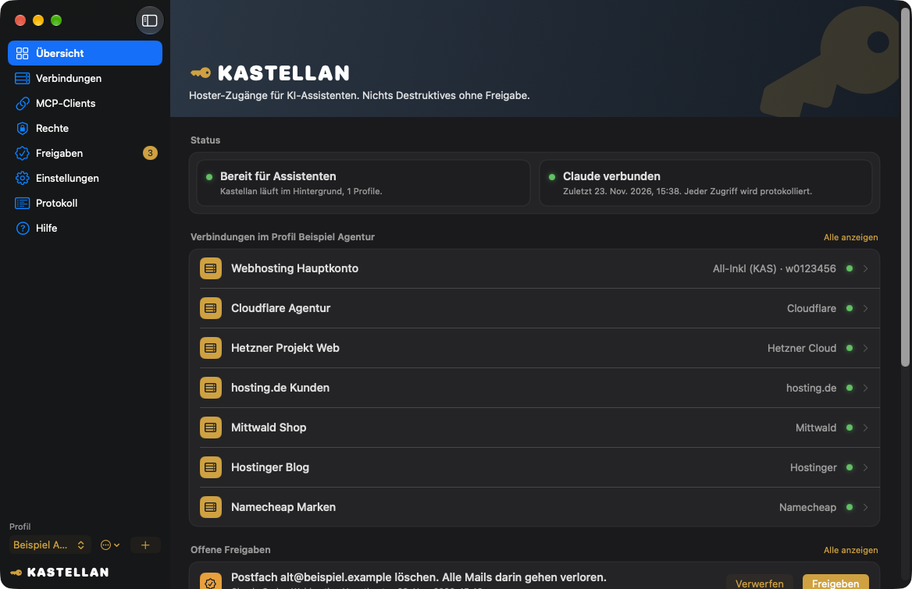
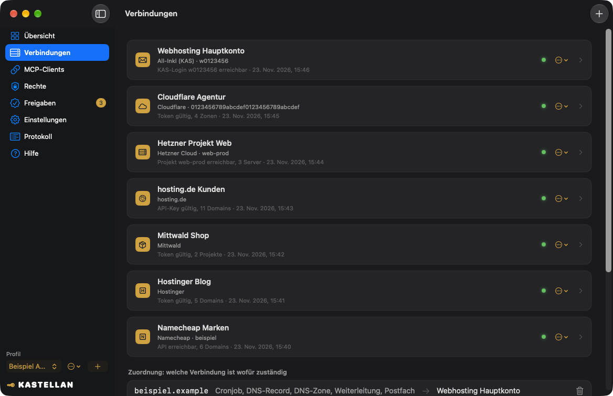
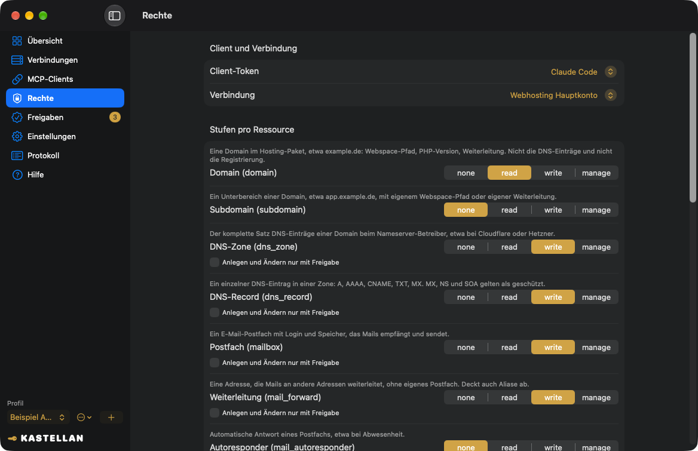
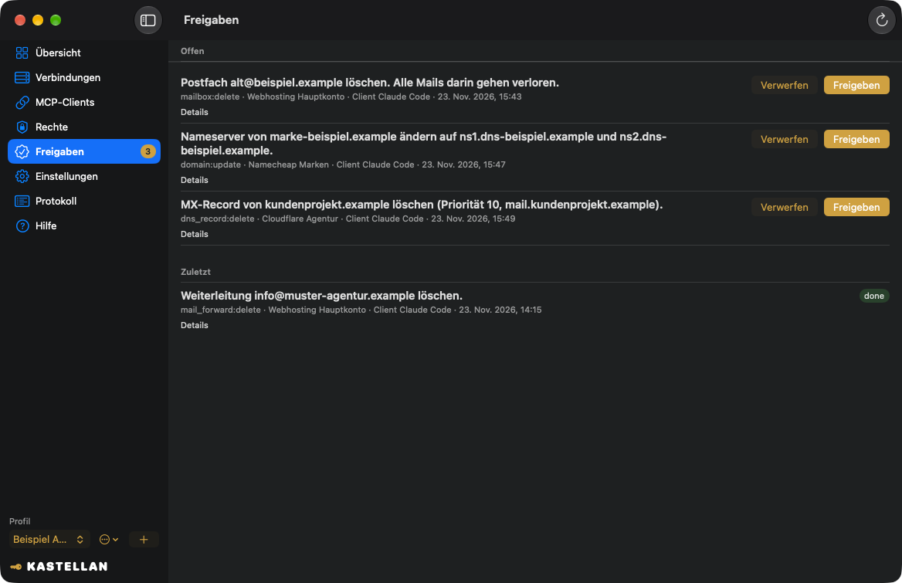
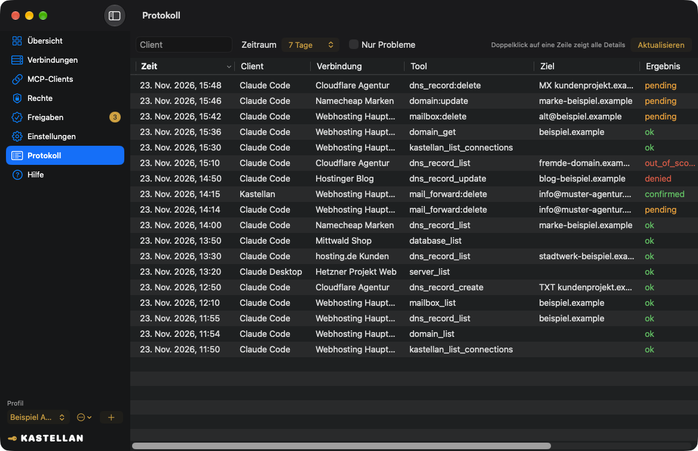
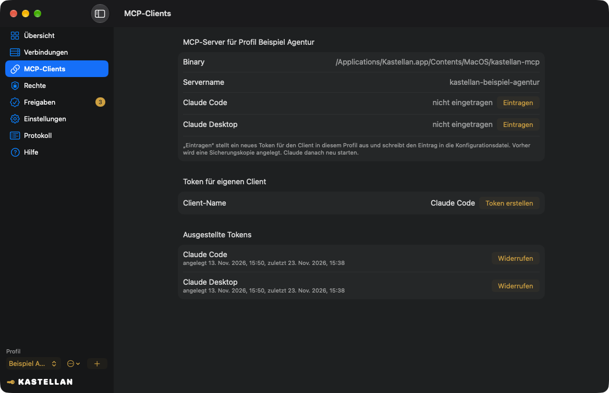

<p align="center">
  
</p>

# Kastellan

[](#installation)
[](#linux-und-windows)
[](Packages/KastellanCore)
[](https://github.com/toolwerk/kastellan/releases/latest)
[](LICENSE)

**Deutsch** · [English](README.en.md)

**Kastellan gibt KI-Assistenten Zugriff auf deine Hoster, ohne ihnen die Schlüssel zu geben.** Die macOS-App verwahrt Zugangsdaten und Rechte für Postfächer, Weiterleitungen, DNS, Datenbanken, Cronjobs und Server bei sieben Anbietern. Ein eingebauter MCP-Server stellt Claude und anderen Agenten genau die Aktionen zur Verfügung, die du erlaubt hast. Alles Heikle, etwa Löschen oder ein Nameserver-Wechsel, bereitet der Assistent nur vor. Ausführen kannst nur du, mit einem Klick auf Freigeben.



Der Name kommt von der Burg: Der Kastellan verwaltete sie im Auftrag des Burgherrn, hielt die Schlüssel, bewachte die Tore und führte Buch. Außerdem steckt KAS drin, die Verwaltungsoberfläche von All-Inkl, mit der das Projekt angefangen hat.

## Wofür das gut ist

Ein Assistent, der DNS-Einträge setzen oder ein Postfach anlegen soll, braucht Zugang zum Hoster. Gibst du ihm den API-Token direkt, kann er alles: auch alle Domains des Kontos löschen, wenn er sich irrt oder jemand ihn mit einem präparierten Text dazu bringt.

Kastellan setzt eine Schicht dazwischen:

- Der Assistent sieht nie ein Passwort oder einen Token. Beides liegt im Schlüsselbund.
- Jeder Assistent bekommt pro Verbindung eine Stufe: keine, lesen, schreiben oder verwalten.
- Löschen und andere unumkehrbare Aktionen laufen über eine Freigabe in der App.
- Jeder Zugriff steht im Protokoll, auch die abgelehnten.

## Was Kastellan kann

### Sieben Anbieter, ein Modell

| Anbieter | Zugang | Schwerpunkte |
|---|---|---|
| All-Inkl (KAS) | KAS-Login und Passwort | Domains, Subdomains, DNS, Postfächer, Weiterleitungen, Autoresponder, DKIM, FTP, Datenbanken, Cronjobs, Verzeichnisschutz |
| Cloudflare | API-Token | DNS-Zonen und Records, Email Routing, Zertifikate lesend |
| Hetzner Cloud | Projekt-Token | DNS, Server mit Power-Aktionen, SSH-Keys, Firewalls lesend |
| hosting.de | API-Key | DNS, Domains, Mail, Webspace-Nutzer, Datenbanken, Cronjobs, Verzeichnisschutz, Zertifikate, Server |
| Mittwald (mStudio) | API-Token | Server, Domains, Ingress, DNS, Mail, MySQL, SSH/SFTP, Cronjobs, Zertifikate, Einladungen |
| Hostinger | API-Token | Domains, DNS mit Probelauf, VPS, Firewalls, Mail, Webhosting-Datenbanken und Cronjobs |
| Namecheap | API-Key, freigegebene IPv4 | Domains mit Nameservern, Lock und Privacy, DNS als ganze Zone, Mail-Weiterleitungen, Zertifikate lesend |

Alle Anbieter erscheinen für den Assistenten gleich. Ein Tool wie `dns_record_list` funktioniert bei Cloudflare, All-Inkl und Namecheap mit denselben Parametern. Was ein Anbieter nicht per API anbietet, bietet Kastellan dort auch nicht an. Welche Aktionen eine Verbindung tatsächlich kann, zeigt die App je Verbindung an.



### Neunzehn Ressourcentypen

Kastellan kennt Domain, Subdomain, DNS-Zone, DNS-Record, Postfach, Weiterleitung, Autoresponder, Mailingliste, DKIM, FTP-Nutzer, SSH-Nutzer, Datenbank, Datenbank-Nutzer, Cronjob, Zertifikat, Verzeichnisschutz, Subaccount, Server und Firewall. Dazu kommen die Aktionen `list`, `get`, `create`, `update`, `set_password` und `delete`. Jeder Adapter meldet vorab, was der Anbieter davon kann. Verlangt ein Assistent etwas, das der Anbieter nicht kann, lehnt Kastellan den Aufruf mit einer klaren Meldung ab und protokolliert ihn.

### Zuordnung: wer ist wofür zuständig

Webspace und Mail liegen oft bei einem Anbieter, DNS bei einem anderen. Unter Verbindungen legst du fest, welche Verbindung für welche Domain und welchen Ressourcentyp zuständig ist. Der Assistent fragt nur nach `beispiel.de` und `dns_record`. Kastellan schickt die Anfrage an den richtigen Anbieter.

### Rechte pro Assistent und Verbindung

Für jeden MCP-Client und jede Verbindung stellst du je Ressourcentyp eine von vier Stufen ein:

| Stufe | Darf |
|---|---|
| `none` | nichts, jeder Aufruf wird abgelehnt und protokolliert |
| `read` | auflisten und lesen |
| `write` | anlegen und ändern |
| `manage` | zusätzlich löschen, nach Freigabe |

Das tatsächliche Recht ist die Schnittmenge aus deiner Einstellung, dem, was der Anbieter kann, und dem Geltungsbereich. Den Bereich schränkst du über Domainmuster, ausgeschlossene Ziele und erlaubte Record-Typen ein, etwa nur `TXT` und `CNAME`. Optional lassen sich Schreibzugriffe pro Stunde begrenzen und weitere Aktionen freigabepflichtig machen.



### Freigaben für alles Heikle

Diese Aktionen führt der Assistent nie selbst aus: Löschen, Änderungen an MX-, NS- und SOA-Records, Nameserver-Wechsel, Domain entfernen, Subaccounts. Der Assistent ruft das passende `prepare`-Tool auf, Kastellan legt eine Vorschau an: was genau passiert, bei welcher Verbindung, für welches Ziel. Du siehst sie unter Freigaben und entscheidest zwischen Verwerfen und Freigeben. Erst dann läuft die Aktion. Die feste Liste lässt sich über Richtlinien erweitern, nicht kürzen.



### Protokoll

Jeder Aufruf landet in `audit.jsonl`: Zeit, Client, Verbindung, Tool, Ziel, Ergebnis und Dauer. Auch abgelehnte Zugriffe, Aufrufe außerhalb des Bereichs und Freigaben stehen darin, ohne Passwörter und Tokens. In der App filterst du nach Client, Zeitraum und Problemen.



### Passwörter

Legt ein Assistent ein Postfach oder einen Datenbank-Nutzer an, kann Kastellan das Passwort erzeugen. Wohin es geht, stellst du je Profil ein: nur ins Ergebnis, in den Schlüsselbund, nach Bitwarden oder nach 1Password. Standardmäßig sieht der Assistent das erzeugte Passwort nicht.

### Profile

Ein Profil bündelt Verbindungen, Zuordnungen, Tokens und Rechte, zum Beispiel eines für die eigene Agentur und eines für einen Kunden. Jedes Profil hat seinen eigenen MCP-Servereintrag. Ein Assistent im Profil „Kunde A“ sieht die Verbindungen von „Kunde B“ nicht.

### MCP-Clients einrichten

Ein Knopfdruck stellt ein Token aus und schreibt den Eintrag in die Konfiguration von Claude Code oder Claude Desktop, mit Sicherungskopie der alten Datei. Weitere Clients bekommen ein eigenes Token mit eigenen Rechten. Tokens lassen sich einzeln widerrufen. Gespeichert werden nur Hashes.



### Das kannst du Claude sagen

Mit einer passenden Verbindung funktionieren Sätze wie diese:

- „Welche Domains haben wir bei All-Inkl, und wann läuft die nächste ab?"
- „Setz für `beispiel.de` einen TXT-Record für die Domain-Verifizierung bei Google."
- „Lege `info@beispiel.de` an und leite es an `team@agentur.example` weiter."
- „Prüf bei allen Domains, ob SPF und DKIM gesetzt sind."
- „Starte den Hetzner-Server `web-1` neu."
- „Lösch das Postfach `alt@beispiel.de`." Das bereitet Claude nur vor. Du bestätigst in der App.

### Weitere Funktionen

- **Selbst aktualisierend:** Die macOS-App prüft beim Start und danach alle 24 Stunden auf neue Versionen, lädt sie im Hintergrund und installiert sie beim nächsten Beenden. Jedes Paket ist zusätzlich mit einem Ed25519-Schlüssel signiert, den Sparkle vor der Installation prüft.
- **Gesundheitsprüfung:** Jede Verbindung wird geprüft, der Stand steht mit Zeitpunkt in der App.
- **Rate-Limits im Adapter:** Kastellan hält die Grenzen der Anbieter ein (zum Beispiel die Wartezeit nach jeder KAS-Antwort) und arbeitet pro Verbindung nacheinander.
- **Gleiches Verhalten ohne Mac:** Terminal-Oberfläche und MCP-Server laufen auch unter Linux und Windows, siehe unten.

## Installation

Die fertige App liegt unter [Releases](../../releases): DMG laden, `Kastellan.app` nach Programme ziehen, starten. Die App ist mit Developer ID signiert und von Apple notarisiert. Voraussetzung ist macOS 14 oder neuer.

Ab Version 0.2.0 aktualisiert sich Kastellan selbst. Abschalten lässt sich das unter Einstellungen → Updates.

Danach in der App:
1. Unter Verbindungen den ersten Hoster anlegen. Zugangsdaten landen im macOS-Schlüsselbund.
2. Unter Rechte festlegen, was ein Assistent je Verbindung darf: keine, lesen, schreiben oder verwalten.
3. Unter MCP-Clients einen Token für Claude Code oder Claude Desktop ausstellen und die Konfiguration schreiben lassen.

### Linux und Windows

Ohne macOS gibt es Kastellan als Terminal-Oberfläche `kastellan` mit dem MCP-Server `kastellan-mcp` daneben. Die Oberfläche kann dasselbe wie die App: Verbindungen anlegen und prüfen, Rechte setzen, MCP-Clients einrichten, Freigaben erteilen, das Protokoll lesen. `kastellan status` zeigt den Zustand ohne Oberfläche.

Linux (x86_64, arm64), für den aktuellen Benutzer nach `~/.local/bin`:

```sh
tools/install-linux.sh --release      # fertige Programme vom neuesten Release
tools/install-linux.sh                # aus dem Checkout bauen (Swift 6)
kastellan autocheck enable            # Freigaben und Ausfälle als Desktop-Mitteilung (systemd-User-Timer)
```

Zugangsdaten liegen im Secret Service des Desktops (`secret-tool` aus libsecret), Daten in `~/.local/state/kastellan`.

Die Linux- und Windows-Pakete sind nicht signiert; `SHA256SUMS` im Release erlaubt die Prüfung mit `sha256sum -c SHA256SUMS`. Windows warnt beim ersten Start per SmartScreen (Weitere Informationen → Trotzdem ausführen).

Windows (x64, arm64, experimentell): ZIP vom Release entpacken und `kastellan.exe` in Windows Terminal starten. Zugangsdaten liegen in der Anmeldeinformationsverwaltung, Daten in `%LOCALAPPDATA%\Kastellan`.

## MCP-Anbindung

Der Server liegt unter `Kastellan.app/Contents/MacOS/kastellan-mcp`. Die App schreibt den Eintrag auf Knopfdruck, von Hand sieht er so aus:

```json
"kastellan": {
  "type": "stdio",
  "command": "/Applications/Kastellan.app/Contents/MacOS/kastellan-mcp",
  "env": { "KASTELLAN_TOKEN": "<Token aus der App>" }
}
```

Ohne gültigen Token startet der Server, meldet aber keine Tools. `kastellan-mcp doctor` zeigt Profile, Verbindungen und ob der Schlüsselbund lesbar ist.

Neben den Ressourcen-Tools (`<ressource>_<aktion>`, zum Beispiel `mailbox_list`) gibt es allgemeine Tools mit Präfix `kastellan_`: Verbindungen und Fähigkeiten auflisten, die eigene Richtlinie lesen, herausfinden, welche Verbindung für eine Domain zuständig ist, offene Freigaben ansehen und, wenn du es erlaubst, bestätigen oder abbrechen. Die Beschreibungen der Tools sind deutsch und englisch.

## Datenschutz

- Zugangsdaten liegen ausschließlich im Schlüsselbund, nie in Dateien oder im Protokoll.
- Kein MCP-Tool schreibt Zugangsdaten. Sie legst du nur in der App an.
- Erzeugte Passwörter gehen je Profil wahlweise nur ins Ergebnis, in den Schlüsselbund, nach Bitwarden oder nach 1Password.
- Fehler-Telemetrie ist standardmäßig aus. Eingeschaltet meldet die App Fehlertyp, Meldung, Komponente, Provider und Aktion an die GlitchTip-Instanz des Projekts oder an eine eigene DSN (`KASTELLAN_SENTRY_DSN`), nie Passwörter, Tokens oder Parameter.
- Keine Analyse, kein Tracking.

## Was Kastellan nicht macht

Keine Scraper für Hoster ohne API, kein Domain-Kauf, keine Rechnungs- oder Vertragsverwaltung.

## Aus dem Quellcode bauen

```
Kastellan/                 SwiftUI-App (Verbindungen, Rechte, Freigaben, Protokoll, Einstellungen)
kastellan-mcp/             MCP-Server (stdio), eingebettet in Kastellan.app/Contents/MacOS
Packages/KastellanCore/    Swift Package: Ressourcenmodell, Rechte, Audit, Adapter je Anbieter
KastellanTests/            App-Tests
tools/                     Build-, Release- und Probe-Skripte
project.yml                XcodeGen-Definition, das .xcodeproj wird daraus erzeugt
```

Voraussetzungen: Xcode 16 oder neuer (Swift 6) und [XcodeGen](https://github.com/yonaskolb/XcodeGen) (`brew install xcodegen`).

```bash
./setup.sh
(cd Packages/KastellanCore && swift test)
xcodebuild -project Kastellan.xcodeproj -scheme Kastellan -destination 'platform=macOS' CODE_SIGNING_ALLOWED=NO build
```

Für einen signierten Build `DEVELOPMENT_TEAM` in `project.yml` auf das eigene Team setzen und `tools/build-and-install.sh` ausführen. App und MCP-Server müssen mit demselben Team signiert sein, sonst können sie die gemeinsamen Schlüsselbund-Einträge nicht lesen. `tools/package-release.sh` baut, signiert mit Developer ID, notarisiert, packt DMG und ZIP und erzeugt den Update-Feed `appcast.xml`. Dafür braucht es den Sparkle-Schlüssel des Projekts im Schlüsselbund; wer selbst verteilt, legt mit `generate_keys --account kastellan` einen eigenen an und trägt dessen öffentlichen Teil als `SUPublicEDKey` in `Kastellan/Info.plist` ein.

### Screenshots neu erzeugen

Die Bilder in `docs/images` zeigen erfundene Daten. `tools/demo/make-demo-home.py <Ordner>` legt dafür ein Datenverzeichnis mit Beispielverbindungen, Rechten, Freigaben und Protokoll an. Die App startest du damit über `KASTELLAN_HOME=<Ordner>`, dein echtes Profil bleibt unberührt.

## Vorbild

Vorbild ist [TorroMail](https://github.com/mahype/TorroMail), übertragen von Mailkonten auf Hosting-APIs.

## Lizenz

MIT, siehe [LICENSE](LICENSE).
